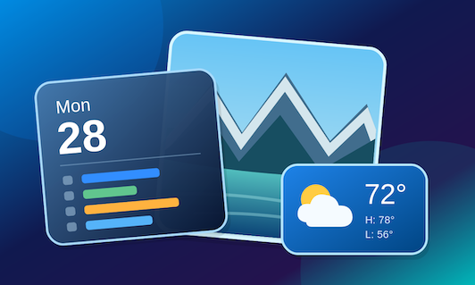

<p align="center">
  
</p>

<h1 align="center">KDB Dashboard</h1>

<p align="center">
  Your day, your photos, and the weather. All on your TV.<br>
  A home dashboard for Apple TV, built with SwiftUI.
</p>

---

KDB Dashboard turns an Apple TV into an always-on display for the house. The left side of the screen shows a month calendar with events from Google Calendar and iCloud. The right side shows a photo slideshow from an album you choose, and below it the weather for one or two zip codes.

There's no backend and no account. The app talks directly to Google, iCloud, and Apple Weather from the Apple TV, and everything it stores stays on the device.

## Features

### Calendar
- Month view with today highlighted and up to four events per day, plus a "+N more" count when a day has more
- Shows Google Calendar (your primary calendar) and iCloud Calendar (all of your calendars) together, with color-coded dots: **orange** for Google, **blue** for iCloud
- Events earlier today that have already ended are dimmed
- Multi-day events show on each day they cover, with the start time on the first day and the end time on the last
- Select a day to list all of its events. Select an event to see its time, location with a map, your RSVP status, meeting link, organizer, attendees and their responses, and notes
- A countdown banner appears when an event starts within 30 minutes ("Upcoming: Soccer Practice in 12 minutes") and shows "Now" for three minutes after it starts
- Refreshes automatically every 5 minutes, with a manual refresh button
- Read-only: the app never creates, changes, or deletes events

### Photos
- Slideshow from any album in the Apple TV's photo library (user albums plus built-in albums like Favorites)
- Random order. Every photo in the album is shown once before any repeats
- Photo interval of 1, 3, 5, 10, 15, or 30 minutes

### Weather
- Powered by Apple WeatherKit
- Current temperature, conditions, high/low, feels-like, and humidity for up to two US zip codes
- Alternates between the two locations every 15 minutes. To switch sooner, highlight the weather and swipe up or down
- Select the weather to see a 5-day forecast, UV index, wind and gusts, pressure, visibility, dew point, cloud cover, and precipitation chance and amount
- Updates every 30 minutes

### General
- Guided first-run setup for the photo album, weather locations, and calendars
- Settings screen to connect or disconnect calendars, change the album, photo interval, and zip codes
- Keeps the Apple TV awake while the app is open, so the screen saver doesn't take over
- Google tokens and iCloud credentials are stored in the Keychain

## How it works

| Source | How it connects |
| --- | --- |
| **Google Calendar** | OAuth 2.0 [Device Authorization Flow](https://developers.google.com/identity/protocols/oauth2/limited-input-device). The TV shows a code that you enter at google.com/device on a phone or computer, so you never type a Google password on the TV. Requests the `calendar.readonly` scope. |
| **iCloud Calendar** | CalDAV (`PROPFIND` / `REPORT`) against `caldav.icloud.com`, authenticated with your Apple ID email and an [app-specific password](https://support.apple.com/en-us/102654). Includes an iCalendar (RFC 5545) parser for events, time zones, and all-day events. |
| **Photos** | PhotoKit (`PHPhotoLibrary`) reading the Apple TV's own photo library / iCloud Photos. |
| **Weather** | WeatherKit, with zip codes geocoded through Core Location. |

## Requirements

- **Xcode 15** or later (developed with Xcode 26)
- **tvOS 17.0** or later (Apple TV or the tvOS Simulator)
- **An Apple Developer Program membership.** WeatherKit only works for apps signed by a paid developer team
- **A Google Cloud project**, only if you want Google Calendar (see below)

## Running it locally

### 1. Clone and open

```bash
git clone https://github.com/kdbdallas/tvOS-Dashboard.git
cd tvOS-Dashboard
open KDBDashboard.xcodeproj
```

The project has no third-party dependencies, so there's nothing else to install.

### 2. Set up signing and WeatherKit

1. In Xcode, select the **KDBDashboard** target and open **Signing & Capabilities**.
2. Set **Team** to your own developer team.
3. Change the **Bundle Identifier** to one you own, for example `com.yourname.KDBDashboard`.
4. Make sure the **WeatherKit** capability is listed. It's already in `KDBDashboard.entitlements`, and automatic signing will register it with your App ID.
5. In the [Apple Developer portal](https://developer.apple.com/account/resources/identifiers/list), open your App ID and confirm **WeatherKit** is checked under both **Capabilities** and **App Services**.

> New WeatherKit registrations can take up to about 30 minutes to start working. If the weather panel says "Unable to fetch weather" right after setup, give it a little time.

### 3. (Optional) Configure Google Calendar

Google credentials are read from a local, gitignored config file. Without it, the app still builds and runs, and you can use iCloud Calendar only.

1. In [Google Cloud Console](https://console.cloud.google.com/), create a project (or pick an existing one).
2. Under **APIs & Services → Library**, enable the **Google Calendar API**.
3. Under **APIs & Services → OAuth consent screen**, configure an **External** app and add the `.../auth/calendar.readonly` scope. While the app is in **Testing** mode, add your Google account as a test user.
4. Under **APIs & Services → Credentials**, create an **OAuth client ID** with the application type **TVs and Limited Input devices**.
5. Copy the example config and fill in the client ID and secret:

   ```bash
   cp Config/Secrets.example.xcconfig Config/Secrets.xcconfig
   ```

   ```
   GOOGLE_CLIENT_ID = 1234567890-abc123.apps.googleusercontent.com
   GOOGLE_CLIENT_SECRET = GOCSPX-your-client-secret
   ```

`Config/Base.xcconfig` includes `Secrets.xcconfig` when it exists, and the values reach the app through `Info.plist`.

> Google expires refresh tokens after 7 days for OAuth apps in **Testing** mode, so you'll need to sign in again weekly until the consent screen is published.

### 4. Build and run

Pick the **Apple TV** simulator or a paired Apple TV and press **⌘R**, or build from the command line:

```bash
xcodebuild -scheme KDBDashboard \
  -destination 'platform=tvOS Simulator,name=Apple TV' \
  build
```

To run on a real Apple TV, pair it with your Mac first: on the Apple TV, open **Settings → Remotes and Devices → Remote App and Devices**, then in Xcode open **Window → Devices and Simulators** and pair it.

> The tvOS Simulator has no photo library, so the slideshow will be empty there. Use a real Apple TV signed in to iCloud Photos to see it.

### 5. Connect your calendars in the app

- **Google:** choose *Sign In with Google*, go to the URL shown on screen from your phone or computer, and enter the code.
- **iCloud:** create an app-specific password at [appleid.apple.com](https://appleid.apple.com) → *Sign-In and Security* → *App-Specific Passwords*, then enter your Apple ID email and that password in the app. Dashes are optional.

## Project structure

```
KDBDashboard/
├── KDBDashboardApp.swift          App entry point
├── ContentView.swift              Main layout (60% calendar / 40% photo + weather); owns the services
├── Models/
│   ├── CalendarEvent.swift        Shared event model with CalendarSource (.google, .icloud)
│   ├── ICloudCalendarModels.swift CalDAV XML parsers and iCalendar VEVENT parser
│   └── WeatherData.swift          Weather display models
├── Services/
│   ├── CalendarManager.swift      Merges Google and iCloud events
│   ├── GoogleCalendarService.swift  OAuth device flow and Calendar API
│   ├── ICloudCalendarService.swift  CalDAV client
│   ├── PhotoService.swift         Album listing and photo rotation
│   ├── WeatherService.swift       WeatherKit and zip code geocoding
│   ├── SettingsManager.swift      UserDefaults-backed settings
│   └── KeychainStore.swift        Keychain wrapper for credentials
└── Views/                         Calendar, photo, weather, settings, onboarding, and sign-in views
Config/
├── Base.xcconfig                  Build settings; includes Secrets.xcconfig if present
└── Secrets.example.xcconfig       Template for your Google OAuth credentials
```

The app follows MVVM. Each service is a `@MainActor` `ObservableObject` that publishes state to SwiftUI views and refreshes itself on a `Task.sleep` loop.

## Privacy

KDB Dashboard has no servers and no analytics. Calendar events, photos, and weather are fetched directly from Google, Apple, and iCloud on the Apple TV and aren't sent anywhere else. Credentials live in the device Keychain, and settings live in `UserDefaults`.

- [Privacy Policy](KDBDashboard-PRIVACY.html)
- [Support & FAQ](KDBDashboard-SUPPORT.html)

## License

KDB Dashboard is released under the [MIT License](LICENSE).

## Disclaimer

KDB Dashboard is an independent project and is not affiliated with, endorsed by, or sponsored by Apple Inc. or Google LLC.
